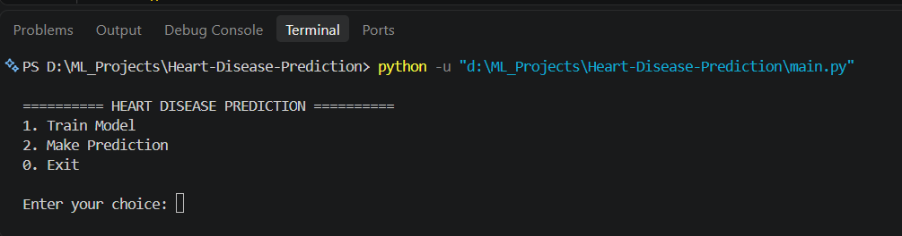
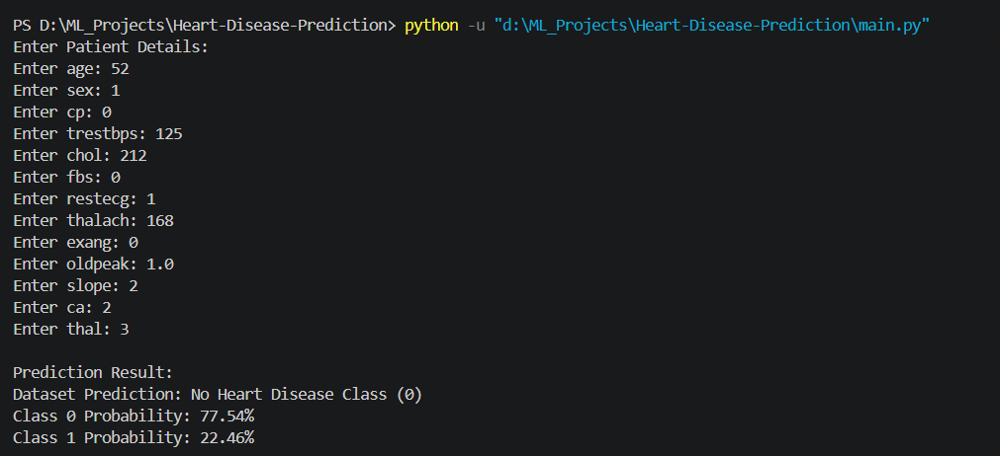

# ❤️ Heart Disease Prediction

A Machine Learning classification project that predicts whether a record belongs to the heart disease class using Logistic Regression and Scikit-learn.

## 📌 Project Overview

This project demonstrates an end-to-end Machine Learning workflow, including data exploration, preprocessing, model training, evaluation, and prediction.

The application provides a simple command-line interface to train the model and make predictions.

## 🛠️ Technologies Used

- Python
- Pandas
- NumPy
- Matplotlib
- Seaborn
- Scikit-learn
- Joblib

## 📂 Project Structure

```text
Heart-Disease-Prediction/
│
├── dataset/
│   └── heart.csv
│
├── models/
├── screenshots/
│   ├── menu.png
│   └── prediction.png
│
├── main.py
├── train_model.py
├── predict.py
├── requirements.txt
├── README.md
└── .gitignore
```

## 📊 Dataset Information

- Original records: 1,025
- Records after removing duplicates: 302
- Input features: 13
- Target column: `target`

Target classes:
- `0` – No Heart Disease Class
- `1` – Heart Disease Class

## 🤖 Machine Learning Workflow

1. Load the dataset using Pandas.
2. Explore and clean the dataset.
3. Remove duplicate records.
4. Separate features and target.
5. Split data into training and testing sets.
6. Apply StandardScaler.
7. Train Logistic Regression.
8. Evaluate model performance.
9. Save the trained model using Joblib.
10. Generate predictions for new records.

## 📈 Model Performance

**Algorithm:** Logistic Regression

| Metric | Score |
|---|---:|
| Training Accuracy | 85.89% |
| Testing Accuracy | 80.33% |
| Precision (Class 1) | 80.00% |
| Recall (Class 1) | 84.85% |
| F1-score (Class 1) | 82.00% |

These results are from one train-test split and are intended for educational evaluation.

## 🖥️ Application Screenshots

### Main Menu



### Prediction Output



## ⚙️ Installation and Execution

### 1. Clone the repository

```bash
git clone https://github.com/amrendra168/Heart-Disease-Prediction.git
cd Heart-Disease-Prediction
```

### 2. Create a virtual environment

```bash
python -m venv venv
```

### 3. Activate the environment

Windows PowerShell:

```powershell
.\venv\Scripts\Activate.ps1
```

### 4. Install dependencies

```bash
pip install -r requirements.txt
```

### 5. Run the application

```bash
python main.py
```

### 6. Train the model

Select option `1` from the menu. This generates the trained model inside the `models` folder.

### 7. Make a prediction

Select option `2` and enter the required feature values.

## 🚀 Future Improvements

- Compare multiple Machine Learning algorithms.
- Implement cross-validation.
- Add model performance visualizations.
- Develop a simple web interface using Streamlit.
- Improve prediction explainability.

## ⚠️ Disclaimer

This project is developed strictly for educational purposes. Predictions are based on a dataset and must not be used for medical diagnosis or treatment decisions.