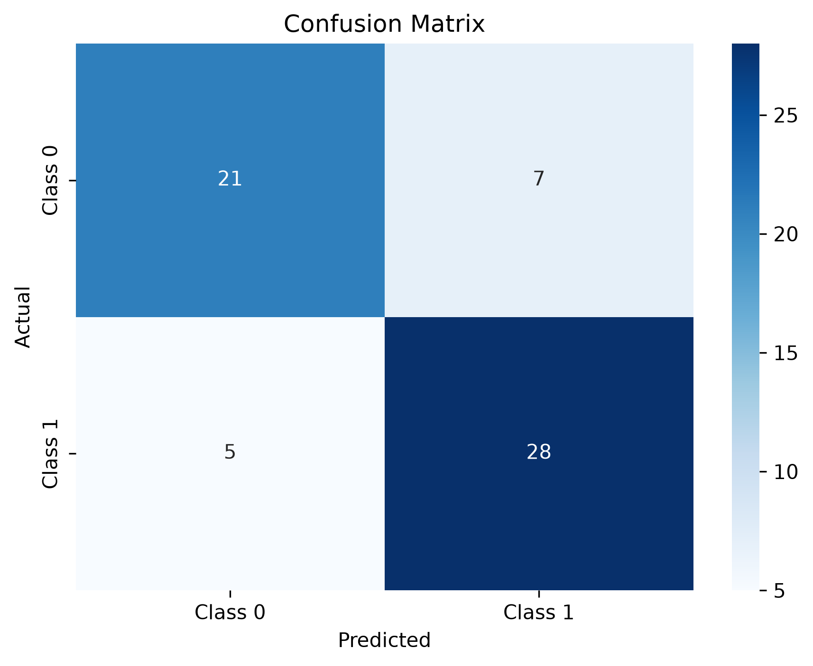
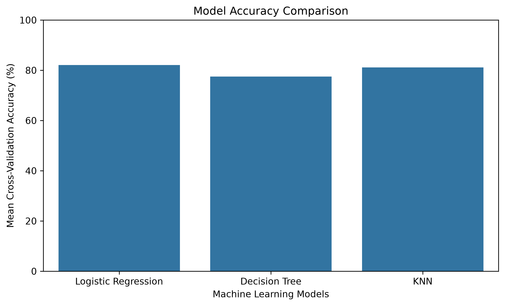
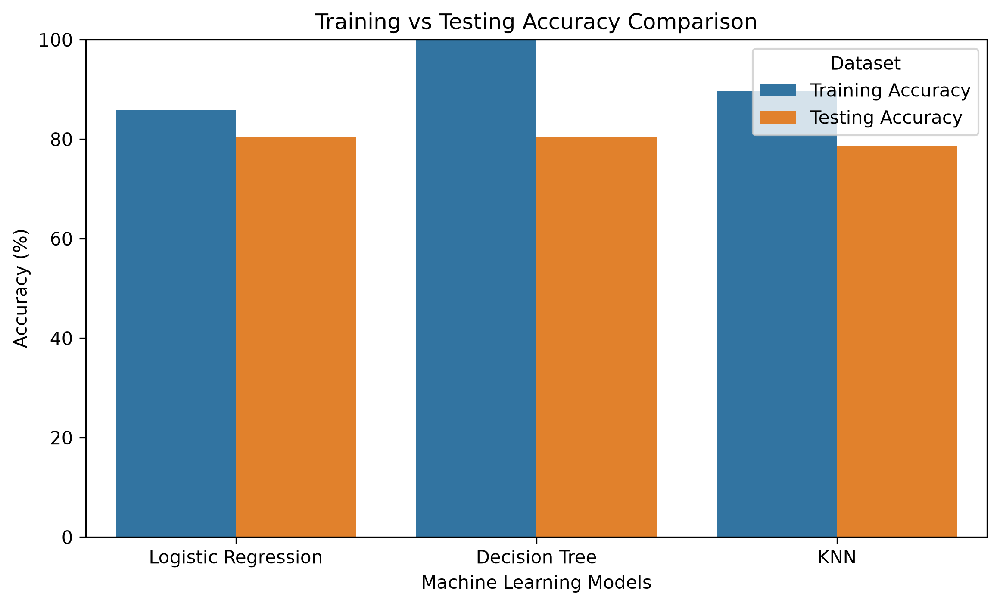

# ❤️ Heart Disease Prediction

A Machine Learning classification project that predicts whether a record belongs to the heart disease class using multiple Machine Learning algorithms and Scikit-learn.

## 📌 Project Overview

This project demonstrates an end-to-end Machine Learning workflow, including data exploration, preprocessing, model training, evaluation, hyperparameter tuning, model comparison, and prediction.

The application provides a simple command-line interface to train the model and make predictions.

Three classification algorithms are evaluated:
- Logistic Regression
- Decision Tree
- K-Nearest Neighbors (KNN)

KNN is selected as the final model based on its highest cross-validation accuracy.

## 🛠️ Technologies Used

- Python
- Pandas
- NumPy
- Matplotlib
- Seaborn
- Scikit-learn
- Joblib

## 📂 Project Structure

```text
Heart-Disease-Prediction/
│
├── dataset/
│   └── heart.csv
│
├── models/
│   └── heart_disease_model.pkl
│
├── screenshots/
│   ├── menu.png
│   ├── prediction.png
│   ├── confusion_matrix.png
│   ├── model_comparison.png
│   └── train_test_comparison.png
│
├── main.py
├── train_model.py
├── predict.py
├── visualize.py
├── tune_model.py
├── model_results.csv
├── requirements.txt
├── README.md
└── .gitignore
```

## 📊 Dataset Information

- Original records: 1,025
- Records after removing duplicates: 302
- Input features: 13
- Target column: `target`

Target classes:

- `0` – No Heart Disease Class
- `1` – Heart Disease Class

## 🤖 Machine Learning Workflow

1. Load the dataset using Pandas.
2. Explore and analyze the dataset.
3. Remove duplicate records.
4. Separate input features and target.
5. Split data into training and testing sets.
6. Apply StandardScaler where required.
7. Train Logistic Regression, Decision Tree, and KNN models.
8. Evaluate models using accuracy and classification metrics.
9. Perform 5-Fold Cross-Validation.
10. Tune model hyperparameters using GridSearchCV.
11. Compare model performance.
12. Select the best model based on cross-validation accuracy.
13. Save the selected model using Joblib.
14. Generate predictions for new records.

## 📈 Model Performance

Three Machine Learning algorithms were evaluated using 5-Fold Cross-Validation and a separate testing dataset.

| Model | CV Accuracy | Testing Accuracy |
|---|---:|---:|
| KNN | **82.99%** | 80.33% |
| Logistic Regression | 82.58% | 80.33% |
| Decision Tree | 79.69% | 80.33% |

### Best Model: K-Nearest Neighbors (KNN)

KNN was selected because it achieved the highest cross-validation accuracy of **82.99%**.

### Best Hyperparameters

```python
{
    'classifier__n_neighbors': 9,
    'classifier__p': 2,
    'classifier__weights': 'uniform'
}
```

### Hyperparameter Tuning

GridSearchCV was used to find the best hyperparameters for each algorithm.

The selected model was saved as:

`models/heart_disease_model.pkl`

The complete comparison results are also saved in `model_results.csv`.

*Note: All three models achieved the same testing accuracy on the selected test split. The KNN model's advantage in this comparison is its slightly higher cross-validation accuracy.*

## 🖥️ Application Screenshots

### Main Menu


### Prediction Output


## 📊 Model Evaluation and Visualizations

The project evaluates model performance using train-test split, 5-Fold Cross-Validation, and confusion matrix analysis.

The following visualizations are generated:

1. **Confusion Matrix:** Displays correct and incorrect predictions.
2. **Model Accuracy Comparison:** Compares Logistic Regression, Decision Tree, and KNN using cross-validation.
3. **Training vs Testing Accuracy:** Compares training and testing performance to help identify overfitting.

### Confusion Matrix



### Model Accuracy Comparison



### Training vs Testing Accuracy



## ⚙️ Installation and Execution

### 1. Clone the repository

```bash
git clone https://github.com/amrendra168/Heart-Disease-Prediction.git
cd Heart-Disease-Prediction
```

### 2. Create a virtual environment

```bash
python -m venv venv
```

### 3. Activate the environment

Windows PowerShell:

```powershell
.\venv\Scripts\Activate.ps1
```

### 4. Install dependencies

```bash
pip install -r requirements.txt
```

### 5. Run the application

```bash
python main.py
```

### 6. Train the model

Select option `1` from the menu to train the model.

### 7. Make a prediction

Select option `2` and enter the required feature values.

### 8. Tune and compare models

```bash
python tune_model.py
```

This performs hyperparameter tuning, compares the models, saves the best model, and generates `model_results.csv`.

### 9. Generate visualizations

```bash
python visualize.py
```

This generates the model evaluation graphs inside the `screenshots` folder.

## 🚀 Future Improvements

- Develop a simple web interface using Streamlit.
- Improve prediction explainability.
- Explore additional Machine Learning algorithms.
- Perform more rigorous model validation.
- Improve the overall user experience.

## ⚠️ Disclaimer

This project is developed strictly for educational purposes. Predictions are based on a dataset and must not be used for medical diagnosis or treatment decisions.
